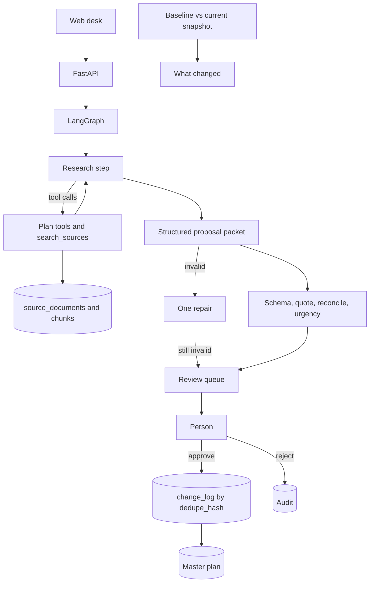
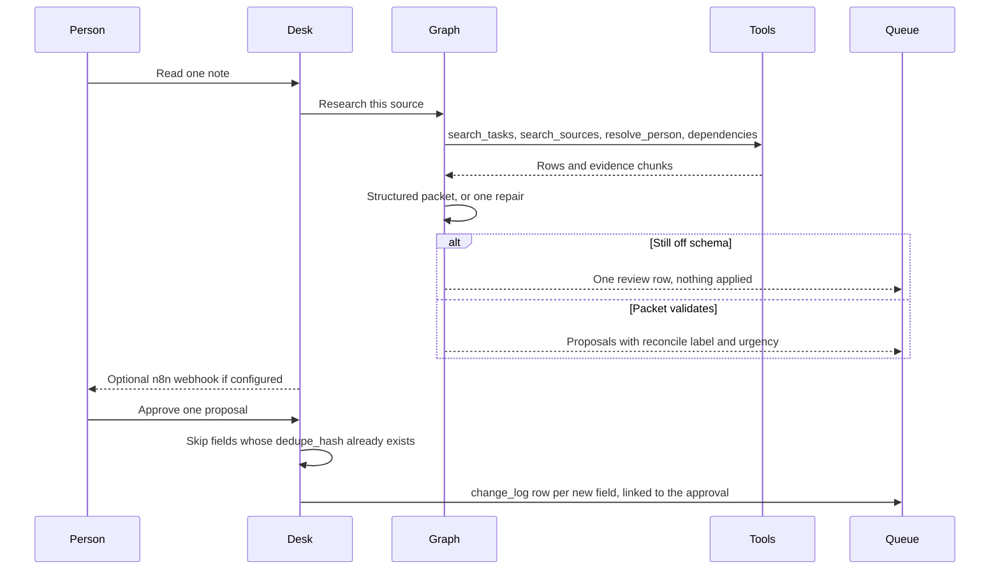

# Project Planner Agent

Codename: Fieldnote

Fieldnote is a personal portfolio build by [Charlene Cordero](https://charlenecordero.com). It is based on the public problem statement from the Code Without Barriers (CWB) Hackathon, published with id8nxt: keep a project plan aligned with what was said in meetings and email, and do not change the plan until a person approves. This repository is that exercise on an open-source stack. It is not a hackathon submission and not work for a client.

The sample projects are fictional. They come from the public CC0 pack [DoreenSteven/CWB_SJ](https://github.com/DoreenSteven/CWB_SJ) (projects, people, tasks, dependencies, plan snapshots, meeting notes, and emails). Nothing here is private data. The app runs with no API key.

## Run it locally

Install [uv](https://docs.astral.sh/uv/), then from this directory:

```bash
uv run fieldnote
```

Open <http://127.0.0.1:43123>. Copy `.env.example` to `.env` only if you want a live model or a different planning clock. `.env` is gitignored. Do not commit it.

Without uv:

```bash
python -m venv .venv
source .venv/bin/activate
pip install -e ".[dev]"
fieldnote
```

Tests: `uv run pytest`.

## What works

- Browse four projects, the master plan, and the gap between each row and the pack’s “current” snapshot.
- Read one meeting or email through a LangGraph tool-calling loop (`search_tasks`, `resolve_person`, `task_dependencies`, `project_risks`).
- Get a schema-validated proposal packet. Every quote has to appear in the source. Unknown people, unknown statuses, and ambiguous titles are refused or sent back for a decision.
- Approve a routine change, resolve a conflict onto a chosen row or a new task, or leave the plan alone.
- Audit log of approvals and refusals. Restore the seed plan when you want a clean desk.

Mock mode is the default. The same graph runs against OpenAI, Anthropic, or any OpenAI-compatible endpoint when you set env vars.

## Architecture





Notes and emails are normalized into `source_documents`, split into chunks, and embedded with a deterministic local vector (hashed bag of words). `search_sources` is a tool the research step calls. Reconciliation labels each candidate `new_task`, `update_existing`, or `conflict_or_ambiguous` from fuzzy title match and that vector score, with a written reason. Urgency is a fixed score from due proximity, blocked status, and how many tasks sit downstream. A live model may add one sentence; mock mode uses the rule sentence.

Off-schema output is repaired once. If it still fails, one row lands on the review queue and the plan is untouched.

Approval writes one `change_log` row per field. The hash is project, subject, field, and new value. The same write does not land twice.

Postgres with pgvector and row-level security is in `sql/schema.sql` and `docker compose up`. Reviewers in `project_members` can read their project and insert approvals. Only `service_role` writes tasks. The process you start with `uv run fieldnote` is SQLite and does not enforce those policies. It is the service role for the local file.

Optional configuration lives in `.env`. Copy the example and edit it. `.env` is gitignored.

```bash
cp .env.example .env
```

| Variable | Default | Role |
| --- | --- | --- |
| `LLM_PROVIDER` | `mock` | `mock`, `openai`, `anthropic`, or `compatible` |
| `LLM_MODEL` | `gpt-4o-mini` | Model name for a live provider |
| `LLM_API_KEY` | empty | Required for OpenAI and Anthropic. Never commit it. |
| `LLM_BASE_URL` | empty | Required for `compatible` (Ollama, Groq, OpenRouter, …) |
| `LLM_TEMPERATURE` | `0` | Sampling temperature for a live provider |
| `AS_OF_DATE` | `2026-03-25` | Planning clock. Overdue is measured against this, not the wall clock. |
| `CHANGE_SHIFT_DAYS` | `3` | Date moves larger than this show on What changed. |
| `N8N_WEBHOOK_URL` | empty | If set, a draft posts JSON here. Empty means no call. |
| `PORT` | `43123` | Listen port |

Ollama example:

```bash
LLM_PROVIDER=compatible
LLM_BASE_URL=http://127.0.0.1:11434/v1
LLM_MODEL=llama3.1
LLM_API_KEY=ollama
```

## Demo script

The planning clock is 25 March 2026, the day of the sample meeting. The desk says so in the header.

1. Open <http://127.0.0.1:43123>. The header should say `mock rules` and the clock date. Four project cards are there. Harbour Bridge Expansion shows blocked work, overdue work, and rows that disagree with the current snapshot.
2. Open **Harbour Bridge Expansion**. The plan table can be filtered to Blocked, Overdue, or Snapshot drift. `T00017` CDE folder structure is In progress, due 23 Mar 2026, owned by Chloe Lee.
3. Open meeting **M0003**, PMO Checkpoint, 25 Mar 2026, 15:00. Choose **Read this note**.
4. The tool trace should include `project_risks`, `search_tasks` (including “CDE folder structure”), `resolve_person`, and `task_dependencies`. Four proposals come back:
   - **New task** — risk register, due 6 Apr 2026. It is not on the plan.
   - **Status, routine** — mark `T00017` Blocked. The quote is highlighted in the note.
   - **Needs a person** — shift risk register from 31 Mar to 11 Apr. There is no row to move yet.
   - **Needs a person** — Aisha Ong to update “weekly update”. Several rows are titled Weekly report, so none is selected.
5. **Approve** the CDE status change. The plan row becomes Blocked. The audit records the quote. The other proposals stay off the plan.
6. On the weekly-update card, either choose **Not this**, or pick one real row (or “A new task”) and **Apply this resolution**. Fieldnote will not choose among the Weekly report rows for you.
7. Open email **E00002**. Read it. “Client presentation” is linked to `T00044` Client presentation deck and to Sofia Singh, with a review flag, because the wording is close and not identical.
8. **Audit** shows each approval and refusal. **Restore the seed plan** on the home page puts the pack back and clears the queue.

To try a live model, set `LLM_PROVIDER`, `LLM_MODEL`, and `LLM_API_KEY`, restart, and read the same note again. The validator still drops a quote that is not in the source. If the provider errors, the page shows the error and the plan is unchanged.

## Tests

```bash
uv run pytest
```

The tests use the mock provider and the vendored seed. They do not call a paid API. They cover title matching, the quote and directory gates, the tool trace on M0003, approval, refusal, and reset.

## Deploy

The app is one Python process. It does not run inside a Cloudflare Worker. LangGraph and the SQLite plan need a container or a small VM. Three ways to put it on a free tier:

**Render.** The repo includes `render.yaml` and a `Dockerfile`. In the Render dashboard, create a Blueprint from this repo (or a web service with the Docker runtime). The service listens on `$PORT` and uses `/health`. Leave `LLM_PROVIDER=mock` to spend nothing on a model. If you add a key, set `LLM_API_KEY` in Render’s environment, not in the image.

**Fly.io.** From a machine with the Fly CLI: `fly launch --dockerfile Dockerfile` and `fly deploy`. Set the same env vars with `fly secrets set LLM_API_KEY=...` only when you leave mock mode.

**Cloudflare Tunnel.** Run the container somewhere it can bind a port, then `cloudflared tunnel --url http://127.0.0.1:43123`. The tunnel is free and does not require opening an inbound port. A Worker can sit in front of a [Cloudflare Container](https://developers.cloudflare.com/containers/) of this image if you want the process on Cloudflare’s network. Do not try to port the graph into a Worker isolate.

There is no login. See the limitations before you put it on a public hostname.

Local Docker check:

```bash
docker build -t fieldnote .
docker run --rm -p 43123:43123 -e LLM_PROVIDER=mock fieldnote
```

## In this slice

One loop, end to end, on the public fictional pack:

1. Open a project and see open, blocked, overdue, and snapshot-drift counts, plus the task rows.
2. Open one meeting note or one email and run the LangGraph research loop.
3. Review schema-checked proposals. Quotes are highlighted in the source. Ambiguous titles stay unresolved.
4. Approve, resolve onto a chosen row or a new task, or leave the plan alone.
5. Open **What changed** for snapshot deltas, and the audit for each approved field.
6. Read the audit, or restore the seed.

Mock mode does this with no API key. Embeddings in that mode are local and deterministic. A live provider uses the same graph and the same checks.

## Out of scope

A full project-planning agent would keep going. This desk does not:

- Chat over a project (“what slipped, and which note said so?”). Health figures and the weekly page are computed from the rows.
- Ingest a live mailbox, calendar, recording, or an uploaded file. Sources are the seeded notes and emails. `search_sources` searches those, not the web.
- A hosted embedding model. Mock mode hashes tokens. It will not notice a paraphrase that shares no words.
- Rebuild a schedule. A date change does not move successors, recompute float, or check who is overloaded. Urgency counts successors; it does not reschedule them.
- Push an approved row to Planner, Jira, or Primavera. The n8n hook is a single POST when a draft is ready, not a workflow.
- Sign-in. `sql/schema.sql` has row-level security for a Postgres role. The SQLite process does not apply it. Do not put real project data on a public URL.
- Score itself against `approvals_queue.csv`. That file points at projects, tasks, and people that are not in this pack, so it is not loaded and it is not a benchmark here.
- Report an accuracy number. Tests cover the safety rules, reconciliation, the change log, and the mock path. They do not grade a live model.

## Status / limitations

- Mock mode only lifts lines that match a clear pattern: create a task, shift a date, mark blocked, assign an owner, confirm a tentative owner, or ask who owns something. A live model can read messier prose. It can also misread a sentence it quotes correctly. The quote check is a substring check, not a claim that the interpretation is right.
- Ambiguous titles stay unresolved. The pack repeats titles (“Weekly report”, “Riser strategy”, and others). Fieldnote will not pick one.
- Task dates in the pack often sit outside the project start and finish. They are shown as published.
- The master rows match the pack’s `baseline` snapshot. “Snapshot drift” is the disagreement with the `current` snapshot. Approving a change can widen that gap. The snapshot is not a write target.
- The planning clock defaults to 25 Mar 2026 so “overdue” means something in this dataset. Set `AS_OF_DATE` to move it. It is not the wall clock.
- The plan is a SQLite file on the server (`data/fieldnote.db`, gitignored). A live provider’s outage or a schema change on that provider is not covered by the tests.

## Layout

```
fieldnote/            Python package: graph, tools, validator, web desk
fieldnote/seed/       Vendored CC0 pack and SOURCE.md
sql/schema.sql        Postgres + pgvector + row-level security
docker-compose.yml    Optional Postgres
tests/                Agent and HTTP tests
Dockerfile            One-process image
render.yaml           Render blueprint
.env.example          Provider settings, no secrets
```

## Data

See `fieldnote/seed/SOURCE.md`. The pack is CC0 1.0 and fictional. Fieldnote is a personal portfolio build by Charlene Cordero, based on the public CWB / id8nxt problem statement.
